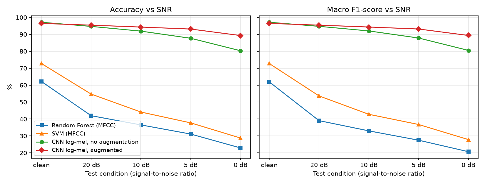
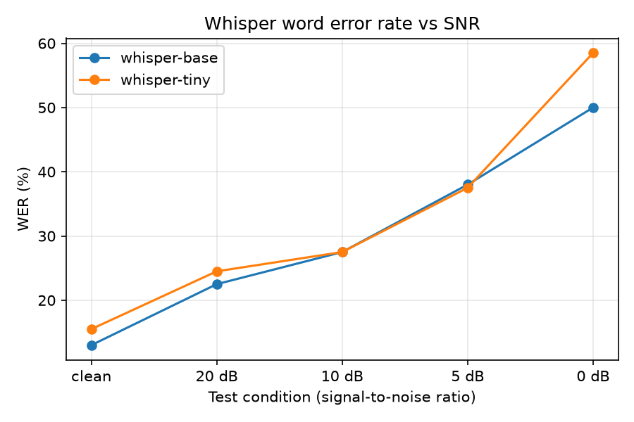

# Speech Audio Classification & Noise Robustness

Spoken keyword recognition on **Google Speech Commands v2** (10 words), comparing a
classical machine-learning pipeline (hand-crafted MFCC features + Random Forest / SVM)
with a **CNN on log-mel spectrograms**, and measuring how each model degrades when
real background noise is added at decreasing signal-to-noise ratios (SNR).
As a bonus, the open-source ASR model **OpenAI Whisper** is evaluated on the same
noisy clips with the word error rate (WER).



## Key results

Test set: 4,074 clips from 239 speakers never seen during training.
Accuracy / macro-F1 (%) under each noise condition:

| Model | Clean | 20 dB | 10 dB | 5 dB | 0 dB |
|---|---|---|---|---|---|
| Random Forest (84 MFCC/spectral features) | 62.2 / 62.0 | 41.9 / 39.0 | 36.5 / 33.0 | 31.1 / 27.5 | 22.9 / 20.7 |
| SVM RBF (same features) | 72.8 / 72.8 | 54.7 / 53.6 | 44.1 / 42.8 | 37.7 / 36.7 | 28.7 / 27.8 |
| CNN log-mel, no augmentation | **97.2 / 97.2** | 94.7 / 94.7 | 91.9 / 92.0 | 87.7 / 87.8 | 80.3 / 80.5 |
| CNN log-mel, noise + shift augmentation | 96.5 / 96.5 | **95.4 / 95.4** | **94.3 / 94.3** | **93.1 / 93.2** | **89.3 / 89.3** |

Whisper (bonus, 200-clip stratified sample, same noisy clips):

| Model | Clean | 20 dB | 10 dB | 5 dB | 0 dB |
|---|---|---|---|---|---|
| Whisper tiny - WER (%) | 15.5 | 24.5 | 27.5 | 37.5 | 58.5 |
| Whisper base - WER (%) | 13.0 | 22.5 | 27.5 | 38.0 | 50.0 |

**Takeaways**

* The **CNN on log-mel spectrograms beats the classical pipeline by ~25 points** on clean
  speech (97 % vs 73 %): learned time-frequency patterns capture *when* each sound happens,
  whereas mean/std summaries of MFCCs throw the temporal order away.
* The **classical models collapse as soon as noise appears** (SVM: 73 % → 55 % at 20 dB,
  29 % at 0 dB), even though 20 dB noise is barely audible. A likely reason: MFCC statistics
  are computed over the whole clip, including the silent parts around the word, and those
  are exactly the frames that noise changes completely.
* **Noise augmentation is a trade-off that pays off**: it costs 0.7 point on clean
  speech but gains **+9 points at 0 dB** (89.3 % vs 80.3 %), and the augmented CNN loses
  only 7 points between clean and 0 dB.
* A general-purpose ASR model (Whisper) is not a keyword spotter: even on clean clips it
  misses ~13-15 % of isolated words, and at 0 dB it gets about one word in two.

## Dataset

[Speech Commands v2](https://arxiv.org/abs/1804.03209) (Warden, 2018): ~105k one-second
clips of 35 words spoken by 2,600+ speakers, recorded by volunteers on their own
devices (CC BY 4.0). This project uses the classic 10-word subset:
`yes, no, up, down, left, right, on, off, stop, go`.

| split | clips  | speakers |
|-------|-------:|---------:|
| train | 30,769 | 2,008 |
| val   |  3,703 |   245 |
| test  |  4,074 |   239 |

The **official split** (`validation_list.txt`, `testing_list.txt`) is used. It assigns
clips by hashing the speaker id, so **no speaker appears in two splits**: test scores
measure generalisation to new voices. `src/data.py` re-checks this and fails if any
speaker is shared. Classes are balanced (~3,000 training clips per word).

The dataset also ships 6 long `_background_noise_` recordings (white noise, pink noise,
running tap, doing the dishes, exercise bike, cat miaowing) used for the noise experiments.

## Method

### 1. Preprocessing (`src/features.py`, Librosa / SoundFile)
1. load as mono float32, resample to **16 kHz** if needed;
2. **pad or crop to exactly 1 s** (16,000 samples, centred) - 8 % of clips are shorter;
3. **peak normalisation** (loudest sample = ±1) to remove microphone / volume differences.

### 2. Classical baseline (`src/train_classic.py`)
For each clip, frame-level descriptors (32 ms window, 10 ms hop) are summarised over
time by their **mean and standard deviation** → an **84-dim vector**:
13 MFCC + 13 Δ + 13 ΔΔ, spectral centroid, zero-crossing rate, RMS energy.

* **Random Forest** and **SVM (RBF, after standardisation)**;
* hyper-parameters tuned with `GridSearchCV` + `PredefinedSplit` on the official
  validation split (random K-fold would mix speakers between folds and inflate scores),
  scored with macro-F1, then refit on train + val.

### 3. CNN on log-mel spectrograms (`src/train_cnn.py`, TensorFlow / Keras 3)
* The model takes the **raw waveform**; its first layer computes a **log-mel
  spectrogram** (40 mel bands, 32 ms window, 10 ms hop) with `tf.signal`, followed by a
  learned per-band normalisation. The same feature code therefore runs at train and test time.
* 4 conv blocks (32-64-128-128 filters, BatchNorm, ReLU, max-pooling, spatial dropout),
  global average pooling, dropout, softmax - **~240k parameters**, sized to train on a
  laptop CPU (~3 min / epoch).
* **On-the-fly data augmentation** on the waveform (different every epoch):
  random **time shift** of ±100 ms, and with probability 0.8 **background noise** at a
  random SNR in [0, 20] dB.
* Adam (lr 1e-3), ReduceLROnPlateau, early stopping on validation loss (≤ 20 epochs).
  Training curves: `results/history_cnn*.png` (validation accuracy is above training
  accuracy for the augmented model because training clips are noisy and dropout is active).
* A second CNN with the **same architecture but no augmentation** isolates the effect
  of augmentation.

### 4. Noise robustness (`src/noise_eval.py`)
Each test clip is mixed with a random excerpt of a background-noise recording, scaled
so that `SNR = 10·log10(P_speech / P_noise)` equals **20, 10, 5 or 0 dB**, then
re-normalised. The same noisy test sets (fixed seed) are fed to every model.

**No noise leakage:** each noise file is cut in two - the first 70 % is only used for
training augmentation, the last 30 % only for test corruption - so the CNN never
hears the exact test noise excerpts during training.

### 5. Whisper bonus (`src/whisper_eval.py`)
A stratified sample of **200 test clips** (20 per word), corrupted exactly as above,
is transcribed by Whisper (`tiny` and `base`, English, greedy decoding). Transcripts
are lower-cased and stripped of punctuation, then scored with **jiwer WER**.
"Keyword accuracy" (the target word appears in the transcript) is also reported.



| Whisper | Clean | 20 dB | 10 dB | 5 dB | 0 dB |
|---|---|---|---|---|---|
| tiny - keyword accuracy (%) | 86.5 | 78.5 | 76.0 | 66.0 | 48.5 |
| base - keyword accuracy (%) | 88.0 | 79.5 | 74.5 | 65.0 | 53.5 |

`base` (74 M parameters) is only slightly better than `tiny` (39 M) and the gap appears
mainly at 0 dB. Typical errors (`results/whisper_*_transcripts.csv`):

* **"off" → "oh" / "ah"**: the weak /f/ fricative is lost - "off" is Whisper tiny's worst
  word even on clean speech (40 % correct);
* **"yes" → "yeah"** in noise: the language model prefers the more frequent conversational form;
* **hallucinations** typical of Whisper on short, noisy inputs: "let's go", "bye",
  "ciao", "hello", or an empty transcript (12 / 200 clips at 0 dB for tiny).

Whisper has no knowledge that only 10 words are possible, which explains most of the gap
with the 10-class CNN (89 % at 0 dB).

## Error analysis

Most frequent confusions on the **clean** test set (count, % of the true word):

| Model | 1st | 2nd | 3rd |
|---|---|---|---|
| SVM | no → go (54, 13 %) | down → no (46, 11 %) | go → no (42, 10 %) |
| Random Forest | go → no (71, 18 %) | left → right (59, 14 %) | down → no (58, 14 %) |
| CNN augmented | go → no (20, 5 %) | off → up (15, 4 %) | down → no (13, 3 %) |

At **0 dB**:

| Model | 1st | 2nd | 3rd |
|---|---|---|---|
| SVM | no → on (39 %) | off → on (34 %) | up → off (32 %) |
| Random Forest | stop → up (31 %) | down → up (30 %) | on → up (30 %) |
| CNN no augmentation | up → off (22 %) | no → go (15 %) | off → on (9 %) |
| CNN augmented | off → up (11 %) | go → no (8 %) | stop → up (6 %) |

* **no / go / down** share the same /oʊ/-like vowel nucleus and differ only by a short
  initial consonant - the pair every model confuses most.
* **left / right** share the final /t/ and similar durations; the classical models,
  which ignore temporal order, confuse them much more than the CNN.
* **up / off / on** are short words dominated by a single vowel whose distinctive
  consonant (/p/, /f/, /n/) is weak and is the first thing noise masks.
* In strong noise the classical models **collapse onto one or two "default" classes**
  (*up* for the RF, *on* for the SVM): noisy feature vectors all fall in the same region,
  far from the clean training distribution. The augmented CNN keeps errors spread over
  the acoustically similar pairs instead.

Confusion matrices: [`results/`](results/) (`confusion_<model>.png` on clean test,
`confusion_<model>_0dB.png` at 0 dB).

## Project structure

```
speech-audio-classification/
├── src/
│   ├── data.py           # download (resumable), extraction, official split, leakage check
│   ├── features.py       # preprocessing, SNR noise mixing, MFCC / spectral / log-mel features
│   ├── evaluate.py       # metrics, confusion matrices, most frequent confusions
│   ├── train_classic.py  # Random Forest & SVM + grid search
│   ├── train_cnn.py      # log-mel CNN + waveform augmentation
│   ├── noise_eval.py     # accuracy / F1 vs SNR for all models
│   └── whisper_eval.py   # Whisper WER vs SNR
├── notebooks/01_exploration.ipynb   # class balance, durations, spectrograms, noise at each SNR
├── results/              # figures and JSON / CSV metrics (committed)
├── tests/                # pytest unit tests (split, padding, SNR mixing, feature shapes)
├── requirements.txt
└── .gitignore            # data/, models/ and logs are not committed
```

## How to run (Windows, Python 3.11)

```powershell
python -m venv .venv
.\.venv\Scripts\Activate.ps1
pip install -r requirements.txt

python -m pytest                         # unit tests
python -m src.data                       # download (2.4 GB, resumable) + split
python -m src.train_classic              # features + RF / SVM grid search  (~30 min)
python -m src.train_cnn                  # augmented CNN                    (~1 h on CPU)
python -m src.train_cnn --no-augment     # CNN without augmentation        (~1 h on CPU)
python -m src.noise_eval                 # robustness curves               (~15 min)
python -m src.whisper_eval --model tiny  # Whisper bonus
python -m src.whisper_eval --model base
```

All commands are run from the project root. Every step caches its intermediate
results (`data/cache/`, `models/`), and CNN training resumes automatically after an
interruption. TensorFlow ≥ 2.11 has no native-Windows GPU support, so everything
runs on CPU.

## Limitations

* **Synthetic noise mixing**: noise is added digitally to clean recordings; real noisy
  speech also has reverberation, Lombard effect (people speak louder in noise) and
  microphone saturation.
* **Only 6 noise types**, and the test noises are other excerpts of the *same*
  recordings used for augmentation - robustness to truly unseen noise types is not measured.
* **Closed vocabulary**: the classifiers must pick one of 10 words; there is no
  "unknown word" or "silence" class, unlike real keyword spotting.
* The classical features discard temporal order (mean / std over time), which
  penalises word pairs that differ mainly by the order of their sounds.
* Whisper is a general-purpose transcriber evaluated on isolated words without
  context, on a 200-clip sample: its WER is not directly comparable to a 10-class
  accuracy.
* CPU-only training limited the CNN size and the number of hyper-parameter trials.

## Possible improvements

* Add the `_unknown_` (other 25 words) and `_silence_` classes for realistic keyword spotting.
* SpecAugment (time / frequency masking), mixup, and room-impulse-response reverberation.
* Evaluate on held-out noise datasets (e.g. MUSAN, DEMAND) to test unseen noise types.
* Classical baseline with temporal features (statistics over several time segments,
  or HMM / DTW on MFCC sequences).
* Stronger audio models: depthwise-separable CNN (DS-CNN), transformers on spectrograms
  (AST), or fine-tuning a self-supervised model (wav2vec 2.0 / HuBERT).
* Constrain Whisper's output to the 10-word vocabulary (prompting or logit biasing).

## References

* P. Warden, *Speech Commands: A Dataset for Limited-Vocabulary Speech Recognition*, arXiv:1804.03209, 2018.
* A. Radford et al., *Robust Speech Recognition via Large-Scale Weak Supervision* (Whisper), 2022.
* B. McFee et al., *librosa: Audio and Music Signal Analysis in Python*, 2015.
